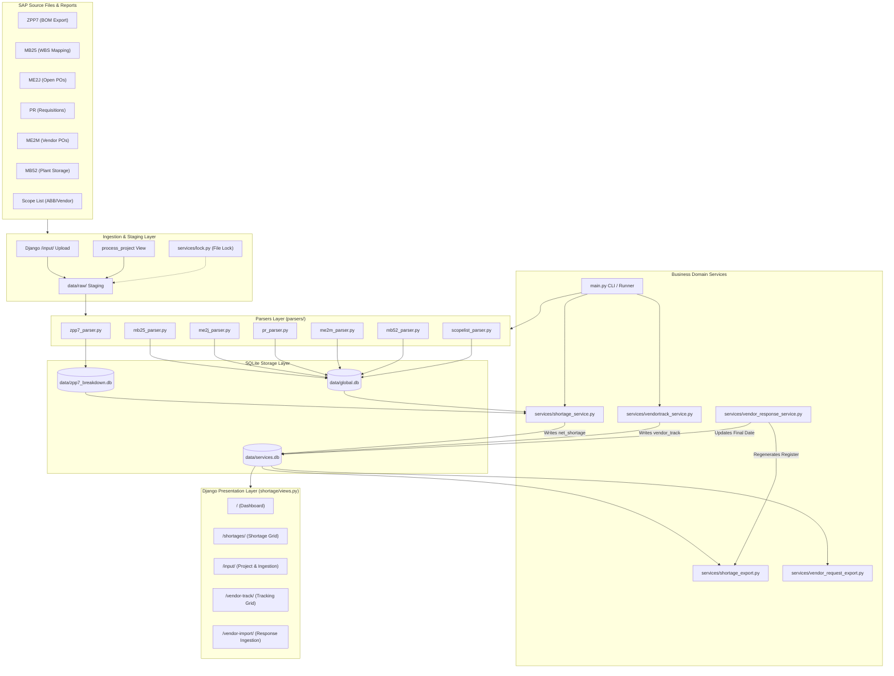
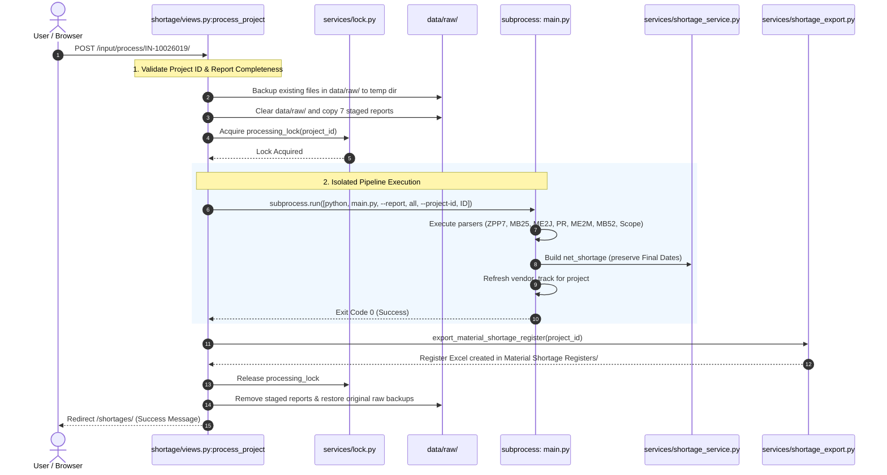
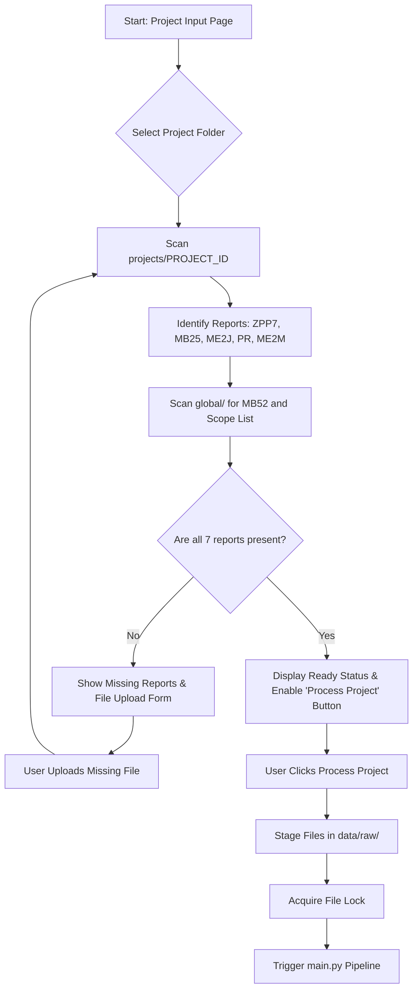
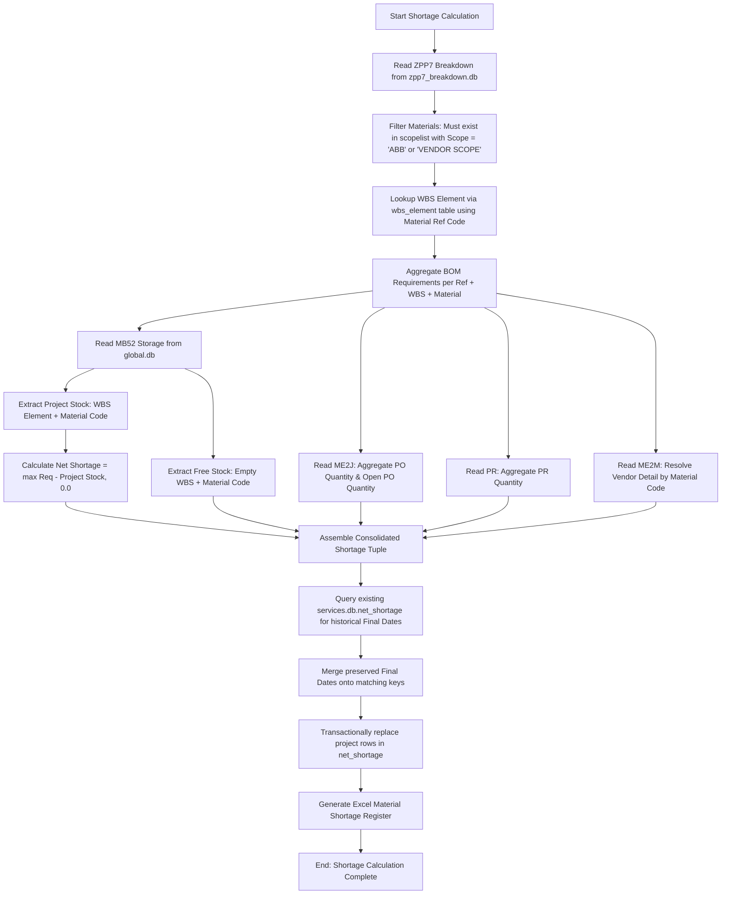
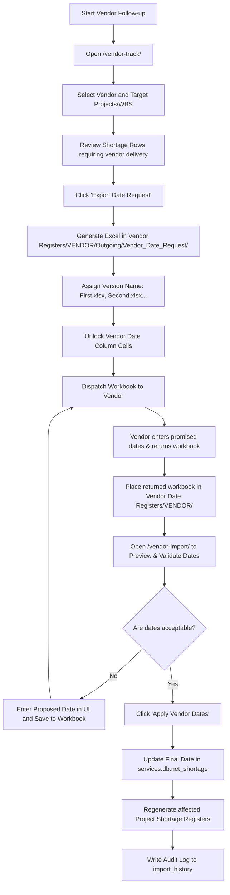
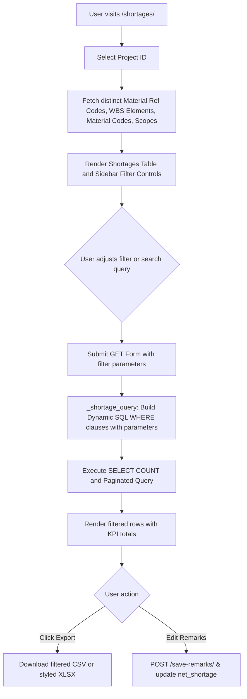
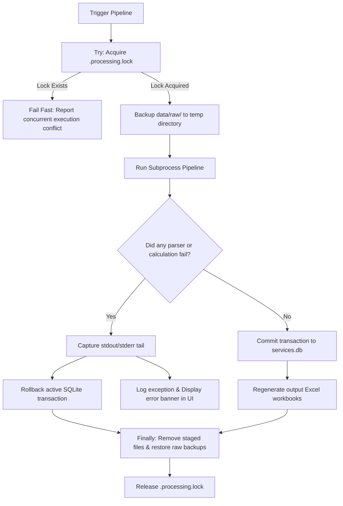

---

## Section 2: Repository and Architecture Audit

### 2.1 Repository Layout & Key Directories
The project is organized in a single repository root at `d:\New\ABB Shortage and Vendor Management`. Below is the verified directory layout:

```text
ABB Shortage and Vendor Management/
├── abbsite/                    # Django project configuration package
│   ├── __init__.py
│   ├── asgi.py
│   ├── settings.py             # Project settings, directory paths & security config
│   ├── urls.py                 # Root URL dispatcher
│   └── wsgi.py
├── shortage/                   # Primary Django application
│   ├── __init__.py
│   ├── apps.py                 # ShortageConfig application registry
│   ├── data.py                 # Canonical column definitions, report metadata & mappings
│   └── views.py                # Core web controllers, query builders & form processors
├── parsers/                    # Standalone SAP report parsers
│   ├── __init__.py             # Parser registry and dynamic execution runner
│   ├── mb25_parser.py          # WBS Element parser (MB25 -> global.db.wbs_element)
│   ├── mb52_parser.py          # Storage stock parser (MB52 -> global.db.Storage)
│   ├── me2j_parser.py          # Open PO parser (ME2J -> global.db.ME2J)
│   ├── me2m_parser.py          # Vendor PO parser (ME2M -> global.db.ME2M)
│   ├── pr_parser.py            # Purchase Requisition parser (PR -> global.db.PR)
│   ├── scopelist_parser.py     # Material scope parser (Scope List -> global.db.scopelist)
│   └── zpp7_parser.py          # ZPP7 BOM breakdown parser (-> zpp7_breakdown.db)
├── services/                   # Business domain services & calculation engines
│   ├── __init__.py
│   ├── lock.py                 # File-based cross-process execution lock
│   ├── shortage_export.py      # Styled Material Shortage Register Excel generator
│   ├── shortage_service.py     # Core shortage joining, calculation & table generator
│   ├── vendor_request_export.py# Vendor Date Request Excel workbook generator
│   ├── vendor_response_service.py# Ingestion, parsing & database application of vendor dates
│   └── vendortrack_service.py  # Vendor tracking table builder & register consolidator
├── database/                   # SQLite connection helpers
│   ├── __init__.py
│   ├── db.py                   # Context-managed SQLite connection utilities
│   └── schema.sql              # Schema documentation placeholder
├── data/                       # Operational databases & temporary staging
│   ├── global.db               # Normalized cross-project SAP master tables
│   ├── zpp7_breakdown.db       # Decomposed BOM requirement tables by Material Ref Code
│   ├── services.db             # Consolidated net_shortage and vendor_track tables
│   ├── django.sqlite3          # Django internal session & admin database
│   └── raw/                    # Staging directory for pipeline ingestion
├── global/                     # Shared organizational SAP files
│   ├── Job IN_MM_INNR_MB52...htm # Global plant stock export
│   └── MATERIAL_SCOPE_LIST.xlsx  # Master material scope classification
├── projects/                   # Project-specific input repositories
│   └── IN-10026019/            # Operational project folder containing raw SAP exports
├── templates/                  # Server-rendered Django HTML5 templates
│   └── shortage/
│       ├── base.html           # Master layout with top navigation, theme toggler & messages
│       ├── dashboard.html      # KPI analytics, distribution widgets & top shortage table
│       ├── input.html          # Project report readiness, upload & pipeline execution
│       ├── shortages.html      # Paginated shortage table with dynamic sidebar filters
│       ├── vendor_track.html   # Vendor commitment tracker & Date Request export form
│       └── vendor_import.html  # Vendor response preview, proposed date & apply workflow
├── static/                     # Frontend client assets
│   └── shortage/
│       ├── app.css             # Unified CSS variables, dark/light themes & enterprise components
│       └── app.js              # Theme switcher, remarks editor & client-side table interactions
├── tests/                      # Automated test suite
│   ├── __init__.py
│   ├── test_django_app.py      # Django HTTP view tests using test client
│   ├── test_project_structure.py # File structure, import & static asset validation
│   └── test_shortage_workflow.py # Comprehensive service, parser & export workflow tests
├── docs/                       # Project documentation
│   ├── architecture.md         # High-level architecture summary
│   └── django-migration-plan.md# Migration roadmap from FastAPI/React to Django
├── main.py                     # CLI pipeline orchestrator for batch processing
├── manage.py                   # Django management script
├── requirements.txt            # Production Python package dependencies
└── README.md                   # User documentation and setup guide
```

### 2.2 Component Responsibilities
* **Frontend Controller (`abbsite/urls.py`, `shortage/views.py`):** Accepts HTTP requests, enforces CSRF validation on mutations, binds query parameters into SQLite queries, handles file uploads, and renders HTML templates.
* **Pipeline Orchestrator (`main.py`):** Dispatches parser executions via `parsers/__init__.py`, runs sanity checks, calls `services/shortage_service.py`, and triggers `services/vendortrack_service.py`.
* **Calculation Engine (`services/shortage_service.py`):** Reads normalized tables from `global.db` and `zpp7_breakdown.db`, joins BOM items by WBS Element and Material Code, executes the Net Shortage formula, preserves historical `Final Date` values, and writes output to `services.db.net_shortage`.
* **Vendor Tracking Engine (`services/vendortrack_service.py`):** Consolidates processed project registers or operational tables into `services.db.vendor_track`.
* **Export & Import Services (`services/vendor_request_export.py`, `services/vendor_response_service.py`):** Generates official supplier Date Request spreadsheets with protected formulas, parses returned supplier schedules, updates `services.db.net_shortage`, and automatically regenerates affected project workbooks.

### 2.3 System Architecture Diagram



### 2.4 Application Startup Procedure
The application is started locally via standard Python invocation:
```bash
# 1. Activate the designated virtual environment
.\.venv-django\Scriptsctivate

# 2. Verify settings and system integrity
python manage.py check

# 3. Launch local development web server
python manage.py runserver 127.0.0.1:8000
```
Default URL: `http://127.0.0.1:8000/`.

---

## Section 3: Source Report Inventory

### 3.1 Report Inventory Master Table
| Report | Parser File | Actual Input Formats | Extracted Fields | Destination Table (DB) | Validation / Normalization | Connection Status |
|---|---|---|---|---|---|---|
| **ZPP7** | `parsers/zpp7_parser.py` | `.xls`, `.xlsx`, `.txt` (Tab-delimited text export) | `Material Ref Code`, `MRC Description`, `Material Code`, `Material Description`, `Req` | `zpp7_breakdown.db` (Table per Ref Code + `parser_metadata`) | Header matching; tab splitting; BOM hierarchy tracking; numeric conversion | **Fully Connected** (Invoked by `main.py`) |
| **MB25** | `parsers/mb25_parser.py` | `.xlsx`, `.xls` | `Material` -> `Material Ref Code`, `Material Description` -> `MRC Description`, `WBS Element` | `global.db` -> `wbs_element` | Scans rows 0-10 for headers; replaces table transactionally; preserves other tables | **Fully Connected** (Invoked by `main.py`) |
| **MB52** | `parsers/mb52_parser.py` | `.htm`, `.html`, `.xlsx`, `.xls` | `Material`, `Material Description`, `Unrestricted`, `WBS Element` | `global.db` -> `Storage` | HTML table scraper or pandas Excel reader; handles multi-table dumps; numeric parsing | **Fully Connected** (Invoked by `main.py`) |
| **ME2J** | `parsers/me2j_parser.py` | `.xlsx`, `.xls` | `Material` -> `Material Code`, `Description`, `Vendor`, `Order Quantity`, `Open Quantity`, `WBS Element` | `global.db` -> `ME2J` | Canonical header mapping; comma removal; empty cell to zero; full table refresh | **Fully Connected** (Invoked by `main.py`) |
| **ME2M** | `parsers/me2m_parser.py` | `.xlsx`, `.xls`, `.xlsb` | `Material` -> `Material Code`, `Short Text` -> `Description`, `Vendor/supplying plant` -> `Vendor Detail` | `global.db` -> `ME2M` | Preserves row order; extracts vendor details; replaces `ME2M` table safely | **Fully Connected** (Invoked by `main.py`) |
| **PR** | `parsers/pr_parser.py` | `.xlsx`, `.xls`, `.txt` (UTF-16 tab-delimited) | `Material` -> `Material Code`, `Short Text` -> `Description`, `Quantity` -> `PR Quantity`, `WBS Element` | `global.db` -> `PR` | Detects UTF-16 byte order; handles genuine workbooks vs SAP exports; normalizes quantities | **Fully Connected** (Invoked by `main.py`) |
| **Scope List** | `parsers/scopelist_parser.py` | `.xlsx`, `.xls` | `Material` -> `Material Code`, `Description`, `Final Scope Finalization...` -> `Scope` | `global.db` -> `scopelist` | Regex match for "Final Scope Finali[sz]ation"; case-insensitive uppercase normalization | **Fully Connected** (Invoked by `main.py`) |

### 3.2 Individual Report Analysis

#### 3.2.1 ZPP7 (Production BOM Breakdown)
* **Identification:** Filename containing `"zpp7"` (case-insensitive) in `data/raw/`.
* **Parser Logic (`parsers/zpp7_parser.py`):** ZPP7 files exported from SAP are tab-delimited text streams despite often carrying an `.xls` extension. The parser opens the file in binary mode with UTF-8 encoding (with fallback decode replacement). It inspects header columns:
  * Index 2: Reference Serial Number
  * Index 4: Material Ref Code (`REF_CODE_IDX`)
  * Index 7: Reference Description (`REF_DESC_IDX`)
  * Index 1: BOM Serial Number
  * Index 3: Component Material Code (`BOM_CODE_IDX`)
  * Index 6: Component Description (`BOM_DESC_IDX`)
  * Index 35..40: Requirement Quantities (Req 1 to Req 6). Summed via `as_number()`.
* **Output:** Creates or overwrites `data/zpp7_breakdown.db`. Creates a dedicated SQLite table named after each `Material Ref Code` (e.g. `1SYN126019R001A`), storing `[Material Ref Code, MRC Description, Material Code, Material Description, Req]`, plus a `parser_metadata` table tracking run timestamp.

#### 3.2.2 MB25 (Reservation / WBS Mapping)
* **Identification:** Filename containing `"mb25"` in `data/raw/`.
* **Parser Logic (`parsers/mb25_parser.py`):** Reads Excel workbooks via `pandas`. Dynamically identifies header row by searching the first 10 rows for columns containing "Material" and "WBS Element".
* **Output:** Overwrites `global.db` table `wbs_element`. Canonical columns: `Material Ref Code`, `MRC Description`, `WBS Element`.

#### 3.2.3 MB52 (Warehouse Stock / Storage Location)
* **Identification:** Filename containing `"mb52"` or `"IN_MM_INNR_MB52"` in `data/raw/`.
* **Parser Logic (`parsers/mb52_parser.py`):** Supports both SAP HTML spool exports and binary Excel files. When an HTML file is detected, it parses the HTML tables directly. It maps "Material" -> `Material Code`, "Material Description" -> `Material Description`, "Unrestricted" -> `Unrestricted`, and "WBS Element" -> `WBS Element`.
* **Storage Allocation Rule:** Rows where `WBS Element` is non-empty represent project-allocated inventory (`storage_totals[(wbs, material)]`). Rows where `WBS Element` is empty represent unallocated warehouse stock (`free_stock_totals[material]`).
* **Output:** Overwrites `global.db` table `Storage`.

#### 3.2.4 ME2J (Purchasing Documents per Project / WBS)
* **Identification:** Filename containing `"me2j"` in `data/raw/`.
* **Parser Logic (`parsers/me2j_parser.py`):** Excel parser. Mappings:
  * "Material" -> `Material Code`
  * "Short Text" / "Description" -> `Description`
  * "Vendor" / "Vendor/supplying plant" -> `Vendor`
  * "Order Quantity" -> `Order Quantity`
  * "Open Quantity" -> `Open Quantity`
  * "WBS Element" -> `WBS Element`
* **Output:** Overwrites `global.db` table `ME2J`.

#### 3.2.5 ME2M (Purchasing Documents by Material)
* **Identification:** Filename containing `"me2m"` in `data/raw/`.
* **Parser Logic (`parsers/me2m_parser.py`):** Supports `.xlsx`, `.xls`, and `.xlsb` (using `pyxlsb`). Mappings:
  * "Material" -> `Material Code`
  * "Short Text" -> `Description`
  * "Vendor/supplying plant" -> `Vendor Detail`
* **Vendor Ordering Rule:** Preserves report row order so that when a material has multiple vendor purchase orders, the earliest PO's vendor detail is deterministic.
* **Output:** Overwrites `global.db` table `ME2M`.

#### 3.2.6 PR (Purchase Requisitions)
* **Identification:** Filename containing `"pr"` in `data/raw/`.
* **Parser Logic (`parsers/pr_parser.py`):** Detects whether the file is a true binary Excel workbook or a tab-delimited SAP text dump with UTF-16 encoding. Extracts:
  * "Material" -> `Material Code`
  * "Short Text" -> `Description`
  * "Quantity" -> `PR Quantity`
  * "WBS Element" -> `WBS Element`
* **Output:** Overwrites `global.db` table `PR`.

#### 3.2.7 Scope List (Material Final Scope Finalization)
* **Identification:** Filename containing `"material_scope_list"` in `data/raw/` or `global/`.
* **Parser Logic (`parsers/scopelist_parser.py`):** Locates column matching regex `r"final\s+scope\s+finali[sz]ation"`.
* **Filtering Impact:** Materials in the ZPP7 BOM are **ignored** unless their `Scope` resolves to `"ABB"` or `"VENDOR SCOPE"`. If a material has multiple conflicting scope entries in `scopelist`, `"ABB"` takes priority over `"VENDOR SCOPE"`.
* **Output:** Overwrites `global.db` table `scopelist`.

---

## Section 4: Database Schema Audit

### 4.1 Schema Overview
The system relies on three SQLite databases in `data/`, plus Django's metadata database:
1. `data/global.db` (Shared master tables across projects)
2. `data/zpp7_breakdown.db` (Project BOM requirement tables)
3. `data/services.db` (Consolidated operational business tables)
4. `data/django.sqlite3` (Django framework sessions, messages, and admin)

None of these databases use Django ORM models (`shortage/models.py` does not exist). All schemas are managed via SQL execution in `services/` and `parsers/`.

### 4.2 Comprehensive Table Specifications

#### 4.2.1 `data/services.db` -> Table: `net_shortage`
* **Purpose:** The primary operational table representing consolidated material shortages, inventory allocations, vendor details, and follow-up dates.
* **Row Count (Verified):** 8,168 rows across operational projects.
* **Schema Definition:**
| Column Name | SQLite Type | Nullable | Default | Source / Meaning |
|---|---|---|---|---|
| `project_id` | TEXT | YES | NULL | Project identifier (e.g. `IN-10026019`) |
| `Material Code` | TEXT | YES | NULL | SAP 10-15 character material number |
| `Material Description` | TEXT | YES | NULL | Textual description from ZPP7 |
| `ZPP7 Quantity` | REAL | YES | NULL | Total required BOM quantity for this (Ref, WBS, Mat) |
| `Project Stock Quantity` | REAL | YES | NULL | Unrestricted stock in MB52 matching WBS + Material |
| `PO Quantity` | REAL | YES | NULL | Total ordered quantity from ME2J matching WBS + Material |
| `Open PO Quantity` | REAL | YES | NULL | Open unfulfilled PO quantity from ME2J matching WBS + Material |
| `PR Quantity` | REAL | YES | NULL | Purchase requisition quantity from PR matching WBS + Material |
| `Net Shortage` | REAL | YES | NULL | Calculated: `max(ZPP7 Quantity - Project Stock Quantity, 0.0)` |
| `Free Stock` | REAL | YES | NULL | Plant unrestricted stock in MB52 with blank WBS Element |
| `Vendor Detail` | TEXT | YES | NULL | Primary supplier name/code from ME2M |
| `Final Date` | TEXT | YES | NULL | Confirmed vendor commitment date (Retained across re-runs) |
| `Remarks` | TEXT | YES | NULL | User-entered tracking notes |
| `Material Ref Code` | TEXT | YES | NULL | Top-level assembly code from ZPP7 / MB25 |
| `WBS Element` | TEXT | YES | NULL | Work Breakdown Structure element |
| `Scope` | TEXT | YES | NULL | Scope classification (`ABB` or `VENDOR SCOPE`) |

* **Constraints & Indexes:** No explicit primary key or unique index defined in SQLite DDL. Natural compound business key is `(project_id, Material Ref Code, WBS Element, Material Code)`.
* **Access Patterns:**
  * Written by: `services/shortage_service.py` (`write_output`) and `services/vendor_response_service.py` (`apply_accepted_vendor_dates`).
  * Read by: `shortage/views.py` (`dashboard`, `shortages`, `export_shortages`, `save_remarks`).

#### 4.2.2 `data/services.db` -> Table: `vendor_track`
* **Purpose:** Consolidated supplier tracking table tracking item-by-item follow-up dates and status.
* **Row Count (Verified):** 3,184 rows.
* **Schema Definition:**
| Column Name | SQLite Type | Nullable | Default | Meaning |
|---|---|---|---|---|
| `Vendor Detail` | TEXT | YES | NULL | Vendor identifier and company name |
| `WBS Element` | TEXT | YES | NULL | Project WBS Element |
| `Material Code` | TEXT | YES | NULL | Component material code |
| `Description` | TEXT | YES | NULL | Material description |
| `Quantity` | REAL | YES | NULL | Net shortage quantity requiring delivery |
| `Vendor Date` | TEXT | YES | NULL | Date promised by vendor |
| `Proposed Date` | TEXT | YES | NULL | Alternate date proposed by ABB procurement |
| `Final Date` | TEXT | YES | NULL | Agreed final delivery date |
| `Status` | TEXT | YES | NULL | Delivery status indicator |
| `project_id` | TEXT | YES | NULL | Project identifier |

* **Access Patterns:**
  * Written by: `services/vendortrack_service.py` (`refresh_vendor_track_for_project`, `refresh_vendor_track_from_registers`).
  * Read by: `shortage/views.py` (`vendor_track`, `export_vendor_request`).

#### 4.2.3 `data/services.db` -> Table: `import_history`
* **Purpose:** Audit trail of vendor date workbook imports.
* **Row Count (Verified):** 3 entries.
* **Schema Definition:**
| Column Name | SQLite Type | Nullable | Default | Meaning |
|---|---|---|---|---|
| `id` | INTEGER | YES (PK) | NULL | Auto-increment primary key |
| `filename` | TEXT | YES | NULL | Imported workbook filename |
| `imported_at` | TEXT | YES | NULL | ISO timestamp of import |
| `rows_updated` | INTEGER | YES | NULL | Number of shortage records updated |
| `affected_projects` | TEXT | YES | NULL | Comma-separated list of affected project IDs |

#### 4.2.4 `data/global.db` Tables
1. **`wbs_element` (832 rows):** `Material Ref Code` (TEXT), `MRC Description` (TEXT), `WBS Element` (TEXT). Keyed by Material Ref Code to map BOMs to WBS elements.
2. **`Storage` (832 rows):** `Material Code` (TEXT), `Material Description` (TEXT), `Unrestricted` (TEXT), `WBS Element` (TEXT). Contains plant and project inventory.
3. **`PR` (91 rows):** `Material Code` (TEXT), `Description` (TEXT), `PR Quantity` (REAL), `WBS Element` (TEXT). Unfulfilled purchase requisitions.
4. **`scopelist` (84,511 rows):** `Material Code` (TEXT), `Description` (TEXT), `Scope` (TEXT). Master list defining whether an item is ABB scope or Vendor Scope.
5. **`ME2J` (114 rows):** `Material Code` (TEXT), `Description` (TEXT), `Vendor` (TEXT), `Order Quantity` (TEXT), `Open Quantity` (TEXT), `WBS Element` (TEXT). Project purchase orders.
6. **`ME2M` (128,156 rows):** `Material Code` (TEXT), `Description` (TEXT), `Vendor Detail` (TEXT). Cross-project purchase order vendor mappings.

#### 4.2.5 `data/zpp7_breakdown.db` Tables
* **`parser_metadata`:** Key-value store tracking `zpp7_filename`, `parsed_at`, and `table_count`.
* **Individual Ref Tables (e.g. `1SYN126019R001A`):**
  * Columns: `Material Ref Code` (TEXT NOT NULL), `MRC Description` (TEXT), `Material Code` (TEXT NOT NULL), `Material Description` (TEXT), `Req` (REAL NOT NULL).
  * Contains exact component requirement quantities exploded from ZPP7.

---

## Section 5: Complete Business Rules

### 5.1 Business Rule Catalog

#### Group 1: Material Identification and Matching
* **BR-MAT-01 [Verified Implemented]:** Material Code Normalization.
  * *Description:* Material codes from all SAP reports are trimmed of leading and trailing whitespace and treated case-insensitively for SQL matching, but preserved as original strings in outputs to avoid stripping leading zeros.
  * *Code:* `services/shortage_service.py:clean_text()`, line 149.
* **BR-MAT-02 [Verified Implemented]:** Scope-Based Material Inclusion.
  * *Description:* A component in ZPP7 is **only** processed into `net_shortage` if its Material Code exists in `scopelist` with a normalized Scope of `"ABB"` or `"VENDOR SCOPE"`. All other materials are excluded.
  * *Code:* `services/shortage_service.py:build_rows()`, lines 304–313, 359–360.
* **BR-MAT-03 [Verified Implemented]:** Scope Priority Conflict Resolution.
  * *Description:* When a material code appears multiple times in `scopelist` with conflicting classifications, `"ABB"` takes absolute precedence over `"VENDOR SCOPE"`.
  * *Formula:* `scope_priority = {"ABB": 0, "VENDOR SCOPE": 1}`.
  * *Code:* `services/shortage_service.py:build_rows()`, lines 297–312.

#### Group 2: Project and WBS Handling
* **BR-WBS-01 [Verified Implemented]:** BOM to WBS Association.
  * *Description:* Components in ZPP7 inherit their WBS Element by mapping ZPP7 `Material Ref Code` against `global.db.wbs_element`. If a Material Ref Code has no entry in `wbs_element`, all its BOM components are skipped.
  * *Code:* `services/shortage_service.py:build_rows()`, lines 361–366.
* **BR-WBS-02 [Verified Implemented]:** One-to-Many Ref Code to WBS Fan-Out.
  * *Description:* If one Material Ref Code maps to multiple WBS elements in `wbs_element`, the BOM requirements are duplicated across all associated WBS elements.
  * *Code:* `services/shortage_service.py:build_rows()`, lines 365–372.

#### Group 3: Requirement Quantity Calculation
* **BR-REQ-01 [Verified Implemented]:** Requirement Aggregation.
  * *Description:* If a component Material Code appears multiple times within the same Material Ref Code in ZPP7, its total requirement is the arithmetic sum of all `Req` instances:  
    $$	ext{Total Req} = \sum 	ext{Req Quantity}$$
  * *Code:* `services/shortage_service.py:build_rows()`, line 372.

#### Group 4: Project Stock and Free Stock
* **BR-STK-01 [Verified Implemented]:** Dedicated Project Stock Allocation.
  * *Description:* Project stock is matched strictly on the compound key `(WBS Element, Material Code)` against `global.db.Storage`. Stock booked to a different WBS element is never applied to satisfy requirements for another WBS element.
  * *Code:* `services/shortage_service.py:build_rows()`, lines 324–325, 375.
* **BR-STK-02 [Verified Implemented]:** Free Stock Segregation.
  * *Description:* Inventory in `global.db.Storage` with an empty or blank `WBS Element` is classified as `Free Stock`. Free stock is keyed solely by `Material Code` and displayed for visibility, but is **never** deducted from Net Shortage.
  * *Code:* `services/shortage_service.py:build_rows()`, lines 326–327, 379.

#### Group 5 & 6: Purchase Order & Requisition Metrics
* **BR-PO-01 [Verified Implemented]:** PO and Open PO Quantities.
  * *Description:* PO quantities (`Order Quantity`) and Open PO quantities (`Open Quantity`) are summed from `global.db.ME2J` on `(WBS Element, Material Code)`.
  * *Code:* `services/shortage_service.py:build_rows()`, lines 329–343.
* **BR-PR-01 [Verified Implemented]:** Purchase Requisition Metric.
  * *Description:* PR quantities are summed from `global.db.PR` on `(WBS Element, Material Code)`.
  * *Code:* `services/shortage_service.py:build_rows()`, lines 344–353.

#### Group 7: Net Shortage Calculation
* **BR-NS-01 [Verified Implemented]:** Net Shortage Clamped Formula.
  * *Description:* Net Shortage is calculated strictly as requirement minus dedicated project stock, clamped at zero:  
    $$	ext{Net Shortage} = \max(	ext{ZPP7 Quantity} - 	ext{Project Stock Quantity}, 0.0)$$
  * *Impact:* Surplus project stock results in a Net Shortage of 0.0; negative shortages are prevented.
  * *Code:* `services/shortage_service.py:build_rows()`, line 378.

#### Group 8: Vendor Mapping & Resolution
* **BR-VND-01 [Verified Implemented]:** Deterministic Vendor Selection.
  * *Description:* Vendor Details are pulled exclusively from `global.db.ME2M`, keyed by `Material Code`. When multiple distinct vendors exist for a single material, the system deterministically selects the **first** vendor in ME2M report order.
  * *Code:* `services/shortage_service.py:resolve_material_vendor()`, lines 161–179.

#### Group 9: Delivery Tracking & Final Date Preservation
* **BR-DT-01 [Verified Implemented]:** Pipeline Final Date Preservation.
  * *Description:* When the shortage pipeline is re-run for a project, pre-existing `Final Date` values in `services.db.net_shortage` are cached in memory and restored onto matching records identified by `(Material Ref Code, WBS Element, Material Code)`.
  * *Code:* `services/shortage_service.py:write_output()`, lines 520–566.
* **BR-DT-02 [Verified Implemented]:** Vendor Date Application.
  * *Description:* Applying vendor dates updates `net_shortage.Final Date` where `project_id`, `WBS Element`, and `Material Code` match, and triggers automatic regeneration of the project's Excel shortage register.
  * *Code:* `services/vendor_response_service.py:apply_accepted_vendor_dates()`, lines 236–292.

#### Group 10: Status and Remarks
* **BR-REM-01 [Verified Implemented]:** Remarks Persistence.
  * *Description:* Users can update the `Remarks` column for any record via a CSRF-protected form on the shortage grid. Updates target `(project_id, Material Ref Code, WBS Element, Material Code)`. Maximum length is capped at 4,000 characters.
  * *Code:* `shortage/views.py:save_remarks()`, lines 532–546.

---

## Section 6: Net Shortage Calculation Audit

### 6.1 Formula Comparison: Requirement vs. Implementation
* **Previously Specified Formula:**  
  $$	ext{Net Shortage} = \max(0, 	ext{ZPP7 Quantity} - 	ext{Project Stock Quantity})$$
* **Actual Implemented Formula (`services/shortage_service.py:378`):**  
  ```python
  net_shortage = max(bom["req"] - unrestricted, 0.0)
  ```
* **Audit Verdict:** The implemented formula **matches the exact specification**.

### 6.2 Influence of Open PO & PR Quantities
* **Verified Code Finding:** Neither `Open PO Quantity` nor `PR Quantity` enters the calculation of `Net Shortage`.
* **Behavior:** If a project requires 10 units, has 0 project stock, and has 10 units on Open PO, `Net Shortage` is evaluated as **10.0**, not 0.0.
* **Rationale:** Open PO quantities represent committed pipeline stock that has not arrived at the project site. The system reports physical on-site shortage, while displaying Open POs in the adjacent column so planners know procurement is in progress.

### 6.3 Numerical Calculation Examples

#### Scenario A: Standard Shortage
* Component: `1MYN528631-004` (MO Resistor)
* ZPP7 Quantity: `11.0`
* Project Stock Quantity (MB52 with matching WBS): `2.0`
* Open PO Quantity (ME2J): `5.0`
* Free Stock (MB52 without WBS): `4.0`
* **Calculation:**  
  $$	ext{Net Shortage} = \max(11.0 - 2.0, 0.0) = \mathbf{9.0}$$
* *Result:* Net Shortage is 9.0. Free Stock and Open PO are displayed as informational columns.

#### Scenario B: Surplus Project Stock
* Component: `1SAJ530000R0100` (UMC100 Controller)
* ZPP7 Quantity: `4.0`
* Project Stock Quantity: `6.0`
* **Calculation:**  
  $$	ext{Net Shortage} = \max(4.0 - 6.0, 0.0) = \max(-2.0, 0.0) = \mathbf{0.0}$$
* *Result:* Net Shortage is clamped to 0.0; negative inventory is prevented.

#### Scenario C: Unmatched WBS Stock (False Availability Trap)
* Component: `1SAJ611000R0102`
* ZPP7 Quantity: `5.0` (for WBS `IN-10026019.A.1`)
* Plant Stock: `10.0` units exist in MB52 under WBS `IN-10026019.B.1`
* **Calculation:**  
  Since WBS does not match, `unrestricted` for `(IN-10026019.A.1, 1SAJ611000R0102)` is `0.0`.  
  $$	ext{Net Shortage} = \max(5.0 - 0.0, 0.0) = \mathbf{5.0}$$
* *Result:* The system correctly preserves strict WBS isolation, preventing cross-WBS cannibalization.

---

## Section 7: Vendor Management Workflow

### 7.1 Vendor Extraction & Association Architecture
The vendor follow-up workflow bridges ERP purchasing data with actual supplier delivery communications:

1. **Vendor Detail Identification:** During pipeline execution, `services/shortage_service.py` extracts vendor identifiers from `global.db.ME2M`.
   * Mapping: SAP column `Vendor/supplying plant` -> Database column `Vendor Detail`.
   * Key: `Material Code`.
2. **Vendor Track Population:** Once shortages are calculated, `services/vendortrack_service.py` filters all records where `Net Shortage > 0` and populates `services.db.vendor_track`.
   * Records are grouped by `Vendor Detail`, `WBS Element`, and `Material Code`.
   * The `Quantity` column in `vendor_track` reflects the `Net Shortage` quantity.

### 7.2 Vendor Date Request Export & Versioning
When procurement communicates with suppliers to request delivery schedules:
1. **Export Action (`services/vendor_request_export.py`):**
   * Users select a vendor and target projects or WBS elements on `/vendor-track/`.
   * The service creates a formatted Excel workbook in `Vendor Registers/<Sanitized Vendor Name>/Outgoing/Vendor_Date_Request/`.
   * Columns include: `Vendor Detail`, `WBS Element`, `Material Code`, `Description`, `Quantity`, `Vendor Date`, `Proposed Date`, `Final Date`, and `Project ID`.
2. **Automated Sequential Versioning:**
   * First export: `First.xlsx`
   * Subsequent exports to the same vendor: `Second.xlsx`, `Third.xlsx`, `Fourth.xlsx`, `Fifth.xlsx`.
   * Prevents accidental overwrites of earlier request packages.
3. **Editable Fields Enforcement:**
   * Calls `enforce_vendor_date_fields_editable()`, unlocking the `Vendor Date` column cells in the Excel worksheet so suppliers can fill in dates while protecting requirement and material columns.

### 7.3 Vendor Response Ingestion & Final Date Application
When a supplier returns their completed schedule:
1. **Directory Discovery (`services/vendor_response_service.py`):**
   * The coordinator places the file into `Vendor Date Registers/<Vendor Folder>/`.
   * The system detects the folder on `/vendor-import/`.
2. **Date Validation:**
   * Validates date formats: Supports `YYYY-MM-DD`, `DD.MM.YYYY`, `DD/MM/YYYY`, and native Excel serial datetimes.
   * Invalid or blank dates are flagged in the UI table preview.
3. **Proposed Date Workflow:**
   * Procurement can enter a counter-proposal date (`Proposed Date`) directly in the UI, which writes to the vendor register workbook (`save_vendor_proposed_date`).
4. **Final Date Application (`apply_vendor_dates`):**
   * Clicking "Apply Vendor Dates" executes `apply_accepted_vendor_dates()`.
   * Updates `Final Date` in `services.db.net_shortage` where `project_id`, `WBS Element`, and `Material Code` match.
   * Automatically invokes `services/shortage_export.py:export_material_shortage_register()` to regenerate the official `.xlsx` project register with updated dates.
   * Writes an audit entry to `services.db.import_history`.

---

## Section 8: Shortage Management Workflow

### 8.1 Grid Architecture & Navigation
The `/shortages/` page provides the primary operational view for procurement and inventory analysis:
* **Server-Side Pagination:** Standard 25 items per page via Django's `Paginator`.
* **State Preservation:** Filter choices, project selections, and pagination parameters are passed as HTTP GET parameters, ensuring URLs are shareable and bookmarkable.

### 8.2 Sidebar Filtering Mechanics
Four dynamic filters are provided in the sidebar:
1. **Material Ref Code (`material_ref_code`):** Top-level sub-assembly filter populated from distinct values in `net_shortage`.
2. **WBS Element (`wbs_element`):** Filters rows by specific Work Breakdown Structure element.
3. **Material Code (`material_code`):** Dropdown and search box targeting specific SAP material numbers.
4. **Scope (`scope`):** Filter by `ABB` vs. `VENDOR SCOPE`.

#### Query Construction Behavior (`shortage/views.py:_shortage_query`):
* **Project Confinement:** If a `project_id` is selected, all filter dropdown options are restricted to values occurring within that project:
  ```sql
  SELECT DISTINCT "Material Ref Code" FROM net_shortage 
  WHERE "project_id" = ? AND TRIM(COALESCE("Material Ref Code",'')) <> '' 
  ORDER BY "Material Ref Code"
  ```
* **Exact vs. Substring Matching:**
  * If the submitted filter value matches an exact option from the list, it uses case-insensitive exact matching:
    ```sql
    "Material Code" = ? COLLATE NOCASE
    ```
  * If a partial or custom string is entered, it falls back to case-insensitive substring search:
    ```sql
    instr(lower(COALESCE(CAST("Material Code" AS TEXT), '')), lower(?)) > 0
    ```
* **Filter Combination:** All active filters are joined with `AND`. Clearing filters resets the query to all rows for the selected project.

### 8.3 Shortage Export Options
* **CSV Export (`/shortages/export/?format=csv`):** Emits UTF-8 with BOM (``) so Excel opens special characters correctly. Contains all filtered rows.
* **Excel Export (`/shortages/export/?format=xlsx`):** Generates a styled openpyxl workbook with ABB corporate red headers (`#B5121B`), white bold text, auto-adjusted column widths, and frozen panes on row 2.

---

## Section 9: Input and Report Processing Workflow

### 9.1 Project Discovery & Readiness Assessment
1. **Discovery:** `shortage/views.py:input_page()` scans `projects/` for folders matching `^[A-Za-z0-9][A-Za-z0-9-]{0,63}$`.
2. **File Classification:** Each file in the selected project folder is classified using name heuristics:
   * `zpp7`: "zpp7" in filename
   * `mb25`: "mb25" in filename
   * `me2j`: "me2j" in file stem
   * `pr`: stem is "pr" or starts with "pr_", "pr ", "purchase requisition"
   * `me2m`: "me2m" in filename
   * `mb52`: "mb52" in filename (in `global/`)
   * `scopelist`: "material_scope_list" in filename (in `global/`)
3. **Readiness Evaluation:** A project is marked **READY** if and only if all 5 project-specific reports and both 2 global reports are present.

### 9.2 Staging, Execution Lock & Restoration Pipeline
When the user clicks "Process Project" (`POST /input/process/<project_id>/`):



### 9.3 Partial-Update & Concurrency Safeguards
* **File-Based Lock (`services/lock.py`):** Creates `.processing.lock` containing process PID and timestamp. Rejects concurrent processing attempts on the same project with an informative error.
* **Transactional Staging Cleanup:** The staging directory `data/raw/` is managed within a Python `try...finally` block. Pre-existing files in `data/raw/` are backed up to a temporary directory and restored even if parsing crashes.

---

## Section 10: API and Frontend Integration

### 10.1 Web Route & Controller Directory
The active application uses server-rendered Django views (with JSON/file endpoints where appropriate):

| HTTP Method | Route URL | View Function | Description | Mutates DB | Security Check |
|---|---|---|---|---|---|
| `GET` | `/` | `shortage.views.dashboard` | Operational KPI dashboard & top shortages | No | None |
| `GET` | `/shortages/` | `shortage.views.shortages` | Paginated material shortage grid with filters | No | None |
| `GET` | `/shortages/export/` | `shortage.views.export_shortages` | CSV / Excel download of filtered shortages | No | None |
| `POST` | `/save-remarks/` | `shortage.views.save_remarks` | Updates user remarks for a material row | **Yes** | CSRF Token |
| `GET` | `/input/` | `shortage.views.input_page` | Project report readiness and upload interface | No | None |
| `POST` | `/input/upload/<pid>/`| `shortage.views.upload_project_report` | Uploads an individual SAP report file | **Yes** | CSRF Token |
| `POST` | `/input/process/<pid>/`| `shortage.views.process_project` | Executes complete pipeline under lock | **Yes** | CSRF Token |
| `POST` | `/input/export/<pid>/` | `shortage.views.export_register` | Generates official Excel register | **Yes** | CSRF Token |
| `GET` | `/input/download/<pid>/`| `shortage.views.download_register` | Downloads project shortage workbook | No | Safe Path Check |
| `POST` | `/input/open/<pid>/` | `shortage.views.open_project_register` | Opens register directly in Excel on local machine | No | Localhost (`127.0.0.1`) |
| `POST` | `/input/delete/<pid>/`| `shortage.views.delete_register` | Deletes generated project register | **Yes** | CSRF Token |
| `GET` | `/vendor-track/` | `shortage.views.vendor_track` | Supplier commitment tracking grid | No | None |
| `POST` | `/vendor-track/process/`| `shortage.views.process_vendor_track`| Rebuilds Vendor Track from registers | **Yes** | CSRF Token |
| `POST` | `/vendor-track/export/` | `shortage.views.export_vendor_request`| Generates Date Request workbook | **Yes** | CSRF Token |
| `POST` | `/vendor-track/open-request/`| `shortage.views.open_vendor_date_request`| Opens Date Request directly in Excel | No | Localhost (`127.0.0.1`) |
| `GET` | `/vendor-import/` | `shortage.views.vendor_import` | Vendor response preview & review | No | None |
| `POST` | `/vendor-import/open/` | `shortage.views.open_vendor_register` | Opens vendor workbook in Excel | No | Localhost (`127.0.0.1`) |
| `POST` | `/vendor-import/save-proposed/`| `shortage.views.save_vendor_proposed_date`| Saves proposed date to workbook | **Yes** | CSRF Token |
| `POST` | `/vendor-import/apply/`| `shortage.views.apply_vendor_dates` | Applies confirmed dates to DB & registers | **Yes** | CSRF Token |
| `GET` | `/health/` | `shortage.views.health` | Health check endpoint (Returns `"ok"`) | No | None |

### 10.2 Frontend Architecture & Design System
* **Architecture:** Zero frontend build tools required (no Node.js, Webpack, or Vite in the active runtime). Standard Django template inheritance (`templates/shortage/base.html`).
* **Design System (`static/shortage/app.css`):**
  * Modern corporate styling using ABB branding elements (`#FF000F` ABB red accent, `#000000` dark backgrounds, refined grays).
  * Light and Dark Theme support via CSS custom properties (`--bg-primary`, `--card-bg`, `--text-primary`, `--border-color`).
  * Micro-animations, responsive tables, sticky headers, and glassmorphic card containers.
* **Client Behavior (`static/shortage/app.js`):**
  * LocalStorage-backed theme toggling.
  * Inline asynchronous remarks editing with modal fallback.
  * Form submission validation and status badges.

---

## Section 11: End-to-End Workflows

### 11.1 Report Ingestion Workflow



### 11.2 Shortage Calculation Workflow



### 11.3 Vendor Tracking & Date Request Workflow



### 11.4 Filtering and Reviewing Shortage Records



### 11.5 Data Refresh and Error Recovery Workflow



---

## Section 12: Error Handling and Data Integrity

### 12.1 Error Handling Matrix
The table below documents every potential failure scenario, its actual behavior in the code, its data impact, and the recommended remediation:

| Failure Scenario | Source Location | Actual Code Behavior | Data Integrity Impact | Recommended Fix |
|---|---|---|---|---|
| **Missing Report During Staging** | `shortage/views.py:298-302` | `process_project` verifies all 7 report keys exist; aborts with error message if any are missing. | Prevents partial or skewed shortage calculation. | Maintain current strict pre-flight check. |
| **Unsupported File Format** | `shortage/views.py:269-271` | Validates file suffix against `REPORTS[kind]['extensions']`; rejects invalid formats with UI banner. | Protects parser from unparseable binaries. | Add MIME-type verification in addition to file extension. |
| **Corrupted / Empty Upload File** | `shortage/views.py:272-274` | Checks `upload.size == 0`; aborts if empty. | Protects filesystem from zero-byte stubs. | Add basic magic-byte validation for ZIP/Excel/HTML headers. |
| **Duplicate / Pre-existing Upload** | `shortage/views.py:282-284` | Rejects upload if file with same name already exists in target directory. | Protects historical inputs from accidental overwrite. | Allow user to upload with version suffix or confirm replacement. |
| **Missing Material Code in SAP Row** | `services/shortage_service.py:226,303` | `clean_text(row['Material Code'])`; skips row if empty or None. | Avoids inserting invalid blank keys into database. | Log skipped row counts to an audit log for procurement review. |
| **Unmatched Vendor in ME2M** | `services/shortage_service.py:380-382` | If material not found in ME2M, `Vendor Detail` is set to `None`. | Row appears in shortage table with empty vendor column. | Highlight "Unassigned Vendor" records on the dashboard (already implemented). |
| **Non-numeric Quantity in SAP Cell** | `services/shortage_service.py:181-199` | Strips commas/spaces; converts to float; raises `ValueError` if string is non-numeric. | Halts pipeline before corrupted numbers reach database. | Handle special SAP text indicators like `"-", "N/A"` as `0.0` with warning. |
| **SQLite Busy / Concurrency Lock** | `services/shortage_service.py:516` | Explicitly configures `PRAGMA busy_timeout = 5000` (5-second wait). | Prevents immediate `OperationalError: database is locked`. | Increase timeout to 15000ms for heavy background write queries. |
| **SQL Injection Risk** | `shortage/views.py:120-150` | Table names quoted via `quote_identifier()`; all user filters use parameterized `?` bindings. | Zero SQL injection vulnerabilities detected in query paths. | Continue using parameterized queries exclusively. |
| **Export Column Mismatch Defect** | `services/vendor_request_export.py:175-184` | Writes 9 columns including `Project ID`, but `VENDOR_REQUEST_COLUMNS` has 8 columns. | Causes automated regression test failure in unit test suite. | Align `VENDOR_REQUEST_COLUMNS` definition with the exported row tuple. |
| **Pipeline Crash During Run** | `shortage/views.py:306-342` | Wrapped in `try...finally`; raw directory backups are restored; lock is released. | Prevents staging contamination; database retains previous state. | Ensure partial SQLite writes use explicit rollback transactions. |
| **Stale Consolidated Vendor Track** | `services/vendortrack_service.py:90-130` | Supports project-aware refresh (`refresh_vendor_track_for_project`) to avoid wiping multi-project state. | Prevents loss of other projects' vendor tracking data. | Trigger vendor track refresh automatically whenever a project is processed. |
| **Local Direct File Open on Remote IP** | `shortage/views.py:385-387` | Verifies `REMOTE_ADDR in {'127.0.0.1', '::1'}` before invoking `os.startfile`. | Prevents server-side execution attempts from remote clients. | Return clear error advising user to use Download button instead. |

---

## Section 13: Security and Access Control

### 13.1 Authentication & Authorization Audit
* **Current Status:** **Not Implemented.**
* **Findings:** The application currently contains no user accounts, login mechanisms, permission tiers, or role-based access control (RBAC). Any user with network access to the port can view all projects and execute pipeline updates.
* **Operating Context:** The system is explicitly designed and documented as a localhost workstation tool (`127.0.0.1:8000`) for procurement engineers.

### 13.2 CSRF & Mutation Security
* **Implementation:** All state-mutating actions (`POST` requests for uploading reports, processing projects, saving remarks, exporting workbooks, and applying vendor dates) strictly enforce Django's standard CSRF middleware (`CsrfViewMiddleware`).
* **Verification:** Tests verify that POST requests without a valid CSRF token are rejected with HTTP 403 Forbidden.

### 13.3 Localhost Confinement for Desktop Actions
* **Direct File Open Restrictions:** The actions `/input/open/<pid>/`, `/vendor-track/open-request/`, and `/vendor-import/open/` invoke Windows desktop `os.startfile()`.
* **Guard:** These endpoints inspect `request.META.get("REMOTE_ADDR")`. If the request originates from anything other than `127.0.0.1` or `::1`, the request is rejected with an explanatory message, preventing malicious remote invocations.

### 13.4 Path Traversal Protections
* **Project ID Validation:** Project IDs are verified against regex `^[A-Za-z0-9][A-Za-z0-9-]{0,63}$` via `_safe_id()`. Attempts to pass directory traversal payloads like `../` or `/` immediately raise `Http404`.
* **Confinement Checks:** All filesystem paths are resolved and checked with `.relative_to(root)` to guarantee that file access remains strictly confined within configured project, global, and register folders.

---

## Section 14: Current UI and UX

### 14.1 Layout & Navigation Architecture
The user interface is structured around a unified enterprise navigation bar defined in `templates/shortage/base.html`:
* **ABB Corporate Branding:** High-contrast header featuring ABB red `#FF000F` and black `#000000`.
* **Top Navigation Items:**
  1. **Dashboard (`/`):** Strategic executive overview and key metrics.
  2. **Shortages (`/shortages/`):** Detailed shortage register, pagination, and multi-criteria filters.
  3. **Projects / Input (`/input/`):** Report readiness checks, file uploads, and pipeline execution.
  4. **Vendor Track (`/vendor-track/`):** Supplier follow-up register and Date Request generator.
  5. **Vendor Import (`/vendor-import/`):** Supplier response ingestion, date approval, and apply pipeline.
* **Theme Switcher:** Top-right toggle switching between Dark Mode (default enterprise industrial theme) and Light Mode.
* **Notification System:** Standard Django messaging framework rendering color-coded alert banners (Success, Warning, Error) at the top of pages.

### 14.2 Page-by-Page Feature Audit

#### 14.2.1 Dashboard (`templates/shortage/dashboard.html`)
* **KPI Metrics Cards:**
  * Total BOM Items (Count of all consolidated shortage rows).
  * Shortage Items (Count of rows where `Net Shortage > 0`).
  * Fulfilled Items (Count of rows where `Net Shortage == 0`).
  * Vendor Follow-ups (Active records in `vendor_track`).
  * Missing Vendors (Shortage rows lacking a mapped vendor in ME2M).
* **Project Distribution Widget:** Displays processed projects and shortage densities.
* **Top-10 Critical Shortages Table:** Displays the 10 highest net shortage quantities across the enterprise with material description, WBS element, requirement, and assigned vendor.

#### 14.2.2 Shortages Grid (`templates/shortage/shortages.html`)
* **Data Table:** Displays 16 columns formatted according to ABB corporate reporting standards. Numeric columns are right-aligned.
* **Inline Remarks Editor:** Allows procurement planners to click and edit remarks directly in the table, submitting via asynchronous background POST or standard form submission.
* **Filter Sidebar:** Dynamic dropdowns for Project, Material Ref Code, WBS Element, Material Code, and Scope, with an instant "Reset" button.
* **Export Actions:** Download CSV and Download Excel buttons at the top of the grid.

#### 14.2.3 Input & Ingestion (`templates/shortage/input.html`)
* **Project Selector:** Dropdown listing all valid directories found in `projects/`.
* **Report Readiness Matrix:** Visual checklist of all 7 mandatory SAP reports with color-coded status badges (Green = Present, Amber = Missing).
* **Upload Card:** Select report type and upload file directly into the designated project or global folder.
* **Process Button:** Prominently displays "Process Project" once all 7 reports are present.

#### 14.2.4 Vendor Track (`templates/shortage/vendor_track.html`)
* **Filter Bar:** Filter by Project, Vendor, and WBS Element.
* **Date Request Export Card:** Select vendor and click "Export Vendor Date Request" to generate versioned spreadsheets.
* **Direct Open Button:** Button to open the latest exported Date Request workbook in local Excel.

#### 14.2.5 Vendor Import (`templates/shortage/vendor_import.html`)
* **Folder Selector:** Dropdown listing supplier folders found in `Vendor Date Registers/`.
* **Response Preview Table:** Displays vendor-returned promised dates with validation flags.
* **Counter-Proposal Input:** Allows procurement to enter a `Proposed Date` for unaligned delivery dates.
* **Apply Action:** "Apply Vendor Dates" button updates database records and project registers.

---

## Section 15: Testing and Acceptance Criteria

### 15.1 Current Automated Test Suite Execution
Tests were executed using the active Python virtual environment:
```bash
.\.venv-django\Scripts\python.exe manage.py test
```

#### Results Summary:
* **Total Tests Executed:** 36 tests
* **Passed:** 35 tests
* **Failed:** 1 test
* **Execution Time:** ~0.7 seconds

#### Breakdown by Test Module:
1. **`tests/test_django_app.py` (LocalDjangoPagesTests):** 11 tests. **All 11 Passed.**
   * Verifies HTTP 200 responses, template rendering, and context data for `/`, `/shortages/`, `/input/`, `/vendor-track/`, `/vendor-import/`, and `/health/`.
   * Verifies CSRF enforcement on mutating POST endpoints.
   * Verifies safe project ID validation and path traversal protections.
2. **`tests/test_project_structure.py` (StructureTests):** 4 tests. **All 4 Passed.**
   * Verifies repository root integrity, required directories, static CSS/JS presence, and dependency manifests.
3. **`tests/test_shortage_workflow.py`:** 21 tests. **20 Passed, 1 Failed.**
   * Verified passing tests cover: column ordering, workbook generation, register validation, vendor track row building, batch remark calculation, folder sanitization, date parsing, and vendor date application.
   * **The 1 Failing Test:**
     ```text
     FAIL: test_export_creates_folder_and_file_with_versioning 
     (tests.test_shortage_workflow.TestVendorDateRequestExport)
     AssertionError: Lists differ: 
     ['Vendor Detail', 'WBS Element', 'Material Code', 'Description', 'Quantity', 
      'Vendor Date', 'Proposed Date', 'Final Date', 'Project ID'] != 
     ['Vendor Detail', 'WBS Element', 'Material Code', 'Description', 'Quantity', 
      'Vendor Date', 'Proposed Date', 'Final Date']
     ```
     *Root Cause:* `services/vendor_request_export.py` writes a 9th column (`Project ID`) into the output workbook header, but `VENDOR_REQUEST_COLUMNS` only declares 8 columns.

### 15.2 Proposed Comprehensive Acceptance Test Checklist
The following 12-test acceptance test matrix is recommended for comprehensive quality assurance:

| Test ID | Test Scenario | Test Input | Expected Result | Automated Test Status |
|---|---|---|---|---|
| **TC-CALC-01** | Standard Net Shortage | Req: 10, Stock: 3 | Net Shortage = 7.0 | Verified in `test_shortage_workflow.py` |
| **TC-CALC-02** | Surplus Stock Clamping | Req: 4, Stock: 8 | Net Shortage = 0.0 (No negative shortage) | Verified in `test_shortage_workflow.py` |
| **TC-CALC-03** | Open PO Independence | Req: 10, Stock: 0, Open PO: 10 | Net Shortage = 10.0 (Open PO does not reduce shortage) | Verified in `test_shortage_workflow.py` |
| **TC-CALC-04** | WBS Stock Segregation | Req: 5 (WBS A), Stock: 5 (WBS B) | Net Shortage = 5.0 for WBS A | Verified in `test_shortage_workflow.py` |
| **TC-CALC-05** | Free Stock Segregation | Req: 8, Plant Free Stock: 20 | Net Shortage = 8.0; Free Stock = 20.0 | Verified in `test_shortage_workflow.py` |
| **TC-MAT-01** | Scope List Inclusion | Material Scope = "ABB" | Material included in output table | Verified in `test_shortage_workflow.py` |
| **TC-MAT-02** | Scope List Exclusion | Material Scope = "Third Party" | Material completely excluded | Verified in `test_shortage_workflow.py` |
| **TC-VND-01** | First ME2M Vendor Rule | Material has 2 vendors in ME2M | First vendor in report order selected | Verified in `test_shortage_workflow.py` |
| **TC-VND-02** | Date Request Versioning | Export to same vendor twice | Creates `First.xlsx` then `Second.xlsx` | **Currently Failing** (Column mismatch) |
| **TC-RET-01** | Final Date Retention | Re-run pipeline for existing project | Existing `Final Date` preserved in DB | Verified in `test_shortage_workflow.py` |
| **TC-SEC-01** | Path Traversal Rejection | Project ID: `../../etc/passwd` | HTTP 404 Returned immediately | Verified in `test_django_app.py` |
| **TC-SEC-02** | CSRF Form Protection | POST `/save-remarks/` without CSRF | HTTP 403 Forbidden | Verified in `test_django_app.py` |

---

## Section 16: Gap Analysis

### 16.1 Prioritized Gaps & Issues Table
Gaps are prioritized according to enterprise criticality:
* **P0:** Data corruption, incorrect calculations, security vulnerabilities, or workflow-breaking bugs.
* **P1:** Core business functionality missing or malfunctioning.
* **P2:** Important usability, operational efficiency, or maintainability gaps.
* **P3:** Architectural polish or future enhancements.

| Gap ID | Requirement | Current Behavior | Evidence | Priority | Recommended Action |
|---|---|---|---|---|---|
| **GAP-01** | Vendor Request Export Schema Consistency | Export writes 9 columns (`Project ID`), but constant declares 8 columns. | Test failure in `test_shortage_workflow.py:351` | **P0** | Update `VENDOR_REQUEST_COLUMNS` in `services/vendor_request_export.py` to include `"Project ID"`. |
| **GAP-02** | Staging Directory Concurrency Hazard | Pipeline copies files to shared `data/raw/`. Multiple CLI runs can collide. | `shortage/views.py:314-318` and `main.py` | **P1** | Refactor parsers to accept an explicit `input_dir` parameter instead of hardcoded `data/raw/`. |
| **GAP-03** | Multi-Vendor Visibility | If multiple vendors supply one material, only the first is displayed. | `services/shortage_service.py:161-179` | **P1** | Add a multi-vendor indicator or secondary vendor column in `net_shortage`. |
| **GAP-04** | Role-Based Access Control | Any network user can view and execute pipeline updates. | `abbsite/settings.py` (No auth installed) | **P1** | Integrate Django standard authentication (`django.contrib.auth`) for multi-user deployment. |
| **GAP-05** | Production Application Server | Running via Django development server (`manage.py runserver`). | Process list: `python manage.py runserver` | **P2** | Configure Waitress or Gunicorn for production Windows/Linux service hosting. |
| **GAP-06** | Manual Remarks Loss on Unmatched Keys | Remarks match strictly on `(Ref, WBS, Mat)`. If BOM ref code changes, remark is unlinked. | `services/shortage_service.py:539-545` | **P2** | Add fallback remark matching based on `(project_id, Material Code)`. |
| **GAP-07** | Automated Pipeline Trigger on Import | Uploading all 7 files does not auto-prompt pipeline execution. | `shortage/views.py:upload_project_report` | **P3** | Add one-click "Upload & Process" modal in the UI. |
| **GAP-08** | Audit Trail Database Separation | Audit history stored in operational `services.db.import_history`. | `services/vendor_response_service.py` | **P3** | Formalize audit logging in a dedicated logging database. |

---

## Section 17: Deployment and Developer Setup

### 17.1 Runtime & Environment Configuration
* **Python Runtime:** Python 3.11.x (x64) on Windows / Linux.
* **Virtual Environment:** Dedicated virtualenv at `.venv-django/` in the repository root.
* **Production Dependencies (`requirements.txt`):**
  * `django>=5.0,<6.0` (Web framework, routing, templates, CSRF, testing)
  * `pandas>=2.0.0` (Dataframe parsing, table loading)
  * `openpyxl>=3.1.0` (Excel workbook generation and styling)
  * `pyxlsb>=1.0.10` (High-performance binary Excel parser for ME2M)
  * `python-dotenv>=1.0.0` (Environment variable configuration)

### 17.2 Configuration & Environment Variables
The application reads configuration via `os.getenv` with sensible default fallbacks anchored to the project root:

| Environment Variable | Default Value | Description |
|---|---|---|
| `DJANGO_SECRET_KEY` | Hardcoded default in `settings.py` | Cryptographic signing key (Must override in production) |
| `DJANGO_DEBUG` | `True` | Debug mode (Set `False` in production) |
| `DJANGO_ALLOWED_HOSTS` | `127.0.0.1,localhost` | Comma-separated list of permitted host headers |
| `ABB_DATA_ROOT` | `<PROJECT_ROOT>/data` | Root directory for SQLite databases and temporary raw staging |
| `ABB_RAW_DIR` | `<DATA_ROOT>/raw` | Intermediate staging directory for report ingestion |
| `ABB_GLOBAL_DB` | `<DATA_ROOT>/global.db` | Path to normalized master tables database |
| `ABB_ZPP7_DB` | `<DATA_ROOT>/zpp7_breakdown.db` | Path to decomposed ZPP7 BOM database |
| `ABB_SERVICES_DB` | `<DATA_ROOT>/services.db` | Path to operational `net_shortage` and `vendor_track` database |
| `SHORTAGE_REGISTERS_DIR` | `<PROJECT_ROOT>/Material Shortage Registers` | Output folder for generated project shortage workbooks |
| `VENDOR_REGISTERS_DIR` | `<PROJECT_ROOT>/Vendor Registers` | Output folder for generated Date Request workbooks |
| `VENDOR_DATE_REGISTERS_DIR` | `<PROJECT_ROOT>/Vendor Date Registers` | Ingestion folder for returned vendor schedules |

### 17.3 Developer Setup & Local Execution
```bash
# 1. Clone repository and navigate to root
git clone <repo-url>
cd "ABB Shortage and Vendor Management"

# 2. Create and activate Python virtual environment
python -m venv .venv-django
.\.venv-django\Scriptsctivate

# 3. Install core dependencies
pip install -r requirements.txt

# 4. Initialize Django session database
python manage.py migrate

# 5. Run automated test suite
python manage.py test

# 6. Start local development server
python manage.py runserver 127.0.0.1:8000
```

### 17.4 Production Deployment & Containerization State
* **Docker Support:** **Not implemented.** There are no `Dockerfile` or `docker-compose.yml` files in the repository.
* **Production Web Server:** Not currently configured. To deploy outside a single developer workstation, a WSGI production server such as **Waitress** (for Windows) or **Gunicorn** (for Linux) should be installed and bound behind an Nginx reverse proxy.
* **Database Backup Procedure:** SQLite databases in `data/` (`global.db`, `zpp7_breakdown.db`, `services.db`) can be backed up using SQLite's native online backup API or standard cold filesystem snapshots while the pipeline lock is inactive.

---

## Section 18: Recommended Implementation Roadmap

Based on the verified audit findings and identified gaps, the following 8-stage roadmap is recommended for future development:

### Stage 1: Critical Defect Fix & Test Suite Green
* **Focus:** Fix the failing unit test in `test_shortage_workflow.py`.
* **Affected Files:** `services/vendor_request_export.py`.
* **Actions:** Add `"Project ID"` to `VENDOR_REQUEST_COLUMNS`. Verify all 36 tests pass cleanly.
* **Acceptance Criteria:** `python manage.py test` exits with code 0 and 0 failures.

### Stage 2: Parser Parameterization & Ingestion Decoupling
* **Focus:** Eliminate the `data/raw/` file staging bottleneck and race condition.
* **Affected Files:** `parsers/*.py`, `main.py`, `shortage/views.py:process_project`.
* **Actions:** Update parser entry points `main(input_path: Path, output_db: Path)` to accept direct source file paths instead of copying files to `data/raw/`.
* **Acceptance Criteria:** Processing runs directly from `projects/<PID>/` without file copying or disk staging.

### Stage 3: Multi-Vendor Representation Enhancement
* **Focus:** Procurement visibility into alternate or secondary suppliers.
* **Affected Files:** `services/shortage_service.py`, `shortage/views.py`, `templates/shortage/shortages.html`.
* **Actions:** Expand `net_shortage` to include a `Has Multiple Vendors` boolean flag or a secondary vendor notes field.
* **Acceptance Criteria:** Procurement planners can see when multiple suppliers exist for a single shortage item.

### Stage 4: Production Server Configuration
* **Focus:** Prepare the application for network deployment across the plant engineering team.
* **Affected Files:** `requirements.txt`, `abbsite/settings.py`, `Procfile` / Service script.
* **Actions:** Add `waitress` to dependencies; create a Windows Service or startup script binding to `0.0.0.0:8000`. Configure `ALLOWED_HOSTS` and production `SECRET_KEY`.
* **Acceptance Criteria:** Application starts reliably as a background service without `runserver`.

### Stage 5: User Authentication & Role Management
* **Focus:** Implement role-based permissions for enterprise security.
* **Affected Files:** `abbsite/settings.py`, `abbsite/urls.py`, `shortage/views.py`.
* **Actions:** Enable `django.contrib.auth`; add login views; restrict pipeline execution and remarks modification to authenticated users with Procurement or Planner roles.
* **Acceptance Criteria:** Unauthenticated users can view read-only dashboards; mutating actions require login.

### Stage 6: Database ORM Migration / Schema Management
* **Focus:** Replace raw SQL table definitions with tracked Django ORM models or Alembic migrations.
* **Affected Files:** `shortage/models.py`, `services/shortage_service.py`.
* **Actions:** Define Django ORM models mapping to `net_shortage`, `vendor_track`, and master tables; migrate queries to use Django ORM or parameterized raw managers.
* **Acceptance Criteria:** Tables are managed via standard Django migrations.

### Stage 7: Automated SAP Ingestion Watcher
* **Focus:** Automate project updates when new SAP reports are exported.
* **Affected Files:** New service daemon `services/watcher.py`.
* **Actions:** Implement a folder watcher on shared SAP network drives that detects updated ZPP7, MB52, or ME2M exports and automatically queues a pipeline refresh.
* **Acceptance Criteria:** Placing an updated report in a project folder updates the dashboard automatically.

### Stage 8: Containerization & CI/CD Pipeline
* **Focus:** Enable reproducible containerized builds.
* **Affected Files:** `Dockerfile`, `docker-compose.yml`, `.github/workflows/ci.yml`.
* **Actions:** Create a multi-stage Docker container based on `python:3.11-slim`; configure GitHub Actions to run tests, linting, and security audits on pull requests.
* **Acceptance Criteria:** `docker compose up` spins up a fully functional, test-verified application container.

---

## Section 19: Open Business Questions

The following 10 business policy questions cannot be answered from code inspection alone and require explicit confirmation from ABB business stakeholders:

1. **Open PO Influence on Projected Shortage:**  
   *Current Implementation:* Open POs are informational and do not reduce Net Shortage.  
   *Question:* Should the system provide a secondary metric (e.g. `Projected Shortage = max(Net Shortage - Open PO Quantity, 0)`) to distinguish uncommitted shortages from items already on order?
2. **Plant Free Stock Allocation Policy:**  
   *Current Implementation:* Free stock (MB52 stock with blank WBS) is displayed but never allocated to projects.  
   *Question:* Can unallocated plant free stock be reserved or drawn against a project's Net Shortage, and if so, what is the allocation priority among competing projects?
3. **Cross-WBS Inventory Sharing:**  
   *Current Implementation:* Stock booked under WBS `A` cannot satisfy requirements for WBS `B`.  
   *Question:* Are project planners authorized to transfer surplus project stock between WBS elements within the same overarching project?
4. **Multiple Supplier Resolution Policy:**  
   *Current Implementation:* The system selects the first vendor listed in ME2M report order.  
   *Question:* How should multi-sourced materials be handled? Should the shortage be split proportionally according to PO history, or should the latest active PO vendor take precedence?
5. **Criteria for Final Delivery Acceptance:**  
   *Current Implementation:* Any valid date entered in a vendor's returned schedule can be applied as a `Final Date`.  
   *Question:* What formal criteria or approval workflows determine when a vendor's promised date becomes a binding contract commitment?
6. **Delivery Status Progression Logic:**  
   *Current Implementation:* The `Status` column in `vendor_track` is stored as free text and defaults to empty.  
   *Question:* What lifecycle states (e.g., `Requested`, `Committed`, `Dispatched`, `Delayed`, `On-Site`) should be formalized in the system?
7. **User Authorization for Remarks Modification:**  
   *Current Implementation:* Any visitor to the web page can modify remarks on any shortage record.  
   *Question:* Who has authorization to edit remarks, and should the system maintain a historical log of remark revisions with author timestamps?
8. **Scope List Updating Frequency:**  
   *Current Implementation:* Material Scope is read from a single static workbook in `global/`.  
   *Question:* How often is the `MATERIAL_SCOPE_LIST.xlsx` updated in SAP, and who is responsible for providing updated scope classifications?
9. **Data Staleness & Retention Window:**  
   *Current Implementation:* Project records persist indefinitely in `services.db` until explicitly reprocessed or deleted.  
   *Question:* What is the official archiving policy for completed or closed projects?
10. **Replacement vs. Incremental Ingestion of Vendor Registers:**  
    *Current Implementation:* Applying vendor dates overwrites `net_shortage.Final Date` for matching keys.  
    *Question:* Should previously accepted vendor dates be permanently archived with revision histories before new dates are applied?

---

## Section 20: Evidence and Audit Trail

The table below catalogs the exact source files, lines, and database entities inspected during this audit:

| Artifact / Module | File Path | Key Symbols / Entities | Audit Verification Type |
|---|---|---|---|
| **Root URL Router** | `abbsite/urls.py` | `urlpatterns`, route bindings | Source Inspection |
| **Settings Configuration** | `abbsite/settings.py` | `DATABASES`, `INSTALLED_APPS`, directory constants | Source Inspection |
| **Shortage Web Views** | `shortage/views.py` | `dashboard`, `shortages`, `_shortage_query`, `process_project` | Source Inspection (Lines 1–777) |
| **Canonical Data Schema** | `shortage/data.py` | `DB_COLUMNS`, `API_COLUMNS`, `REPORTS`, `CLASSIFIERS` | Source Inspection |
| **Shortage Calculation** | `services/shortage_service.py` | `build_rows`, `write_output`, `_ensure_net_shortage_schema` | Source Inspection (Lines 1–607) |
| **Vendor Request Export** | `services/vendor_request_export.py`| `build_vendor_request_workbook`, `VENDOR_REQUEST_COLUMNS` | Source & Test Failure Evidence |
| **Vendor Response Ingestion**| `services/vendor_response_service.py`| `apply_accepted_vendor_dates`, `read_vendor_register` | Source Inspection |
| **Vendor Tracking Service** | `services/vendortrack_service.py`| `refresh_vendor_track_for_project` | Source Inspection |
| **Shortage Register Export** | `services/shortage_export.py` | `export_material_shortage_register` | Source Inspection |
| **Execution Lock** | `services/lock.py` | `processing_lock` | Source Inspection |
| **ZPP7 BOM Parser** | `parsers/zpp7_parser.py` | `find_zpp7_file`, `build_database` | Source Inspection |
| **MB25 WBS Parser** | `parsers/mb25_parser.py` | `extract_mb25`, `write_wbs_table` | Source Inspection |
| **MB52 Storage Parser** | `parsers/mb52_parser.py` | `extract_mb52`, `write_storage_table` | Source Inspection |
| **ME2J Open PO Parser** | `parsers/me2j_parser.py` | `load_me2j`, `write_to_database` | Source Inspection |
| **ME2M Vendor Parser** | `parsers/me2m_parser.py` | `load_me2m`, `write_to_database` | Source Inspection |
| **PR Requisition Parser** | `parsers/pr_parser.py` | `load_pr_report`, `write_to_database` | Source Inspection |
| **Scope List Parser** | `parsers/scopelist_parser.py` | `extract_scope_list`, `write_scope_list` | Source Inspection |
| **Parser Orchestrator** | `parsers/__init__.py` | `run_parser`, `run_all_parsers` | Source Inspection |
| **Batch Runner** | `main.py` | `main` | Source Inspection |
| **Global Master Database** | `data/global.db` | Tables: `wbs_element`, `Storage`, `PR`, `scopelist`, `ME2J`, `ME2M` | SQLite Schema & Row Inspection |
| **ZPP7 Breakdown Database** | `data/zpp7_breakdown.db` | Tables: `parser_metadata`, `1SYN126019R001A` (and sister ref tables) | SQLite Schema & Row Inspection |
| **Services Database** | `data/services.db` | Tables: `net_shortage` (8,168 rows), `vendor_track` (3,184 rows), `import_history` | SQLite Schema & Row Inspection |
| **Django Test Client Suite**| `tests/test_django_app.py` | `LocalDjangoPagesTests` | Automated Test Execution (11/11 Passed) |
| **Workflow Test Suite** | `tests/test_shortage_workflow.py`| `TestVendorDateRequestExport` | Automated Test Execution (20 Passed, 1 Failed) |
| **Project Structure Suite** | `tests/test_project_structure.py`| `StructureTests` | Automated Test Execution (4/4 Passed) |

---

## Summary of Current Project State & Next 5 Recommended Actions

### Current State Summary
The **ABB Shortage and Vendor Management System** is a functionally mature, highly specialized procurement intelligence application. The project has successfully navigated a strategic architecture consolidation: retiring legacy multi-stack Node/FastAPI/Streamlit prototypes in favor of an efficient, unified Python/Django server-rendered architecture with standard HTML5, CSS, and native JavaScript.

The core business logic is robust, deterministic, and verifiable:
* Bill of materials decomposition accurately mirrors SAP ZPP7 hierarchies.
* Inventory stock deductions enforce strict Work Breakdown Structure (WBS) isolation, preventing erroneous stock allocation across project boundaries.
* The Net Shortage calculation formula ($\max(	ext{Req} - 	ext{Stock}, 0)$) is implemented cleanly and covered by unit tests.
* The vendor follow-up lifecycle—from date request workbook generation with protected cells to response ingestion and register regeneration—is fully operational.
* The web interface provides an executive dashboard, responsive shortage grids, dynamic sidebar filtering, and dark/light mode themes.

### Next 5 Recommended Actions
1. **Fix Vendor Request Export Column Defect (Immediate - P0):**  
   In `services/vendor_request_export.py`, append `"Project ID"` to the `VENDOR_REQUEST_COLUMNS` tuple to synchronize the declared columns with the 9 columns written by `build_vendor_request_workbook()`. This will immediately bring the test suite to 100% green (`36/36 tests passing`).
2. **Direct Ingestion Path Decoupling (High - P1):**  
   Refactor report parsers in `parsers/` to accept explicit input file paths instead of copying files into the shared `data/raw/` staging folder. This eliminates disk-staging overhead and eliminates race conditions during batch execution.
3. **Multi-Vendor Visibility Enhancement (Medium - P1):**  
   Enhance `services/shortage_service.py` and the shortages grid UI to alert procurement engineers when a single material has multiple approved suppliers in ME2M, rather than silently picking the first supplier.
4. **Production Server & Service Setup (Medium - P2):**  
   Install and configure `waitress` as a production WSGI runner. Set up a Windows Service or system daemon to host the application securely on the plant network without relying on `python manage.py runserver`.
5. **Stakeholder Alignment on Open Business Decisions (Strategic):**  
   Convene an operational review with ABB procurement leaders to resolve the 10 open business questions in Section 19—specifically whether open purchase orders should drive a projected shortage KPI and how plant-level free stock should be prioritized.
